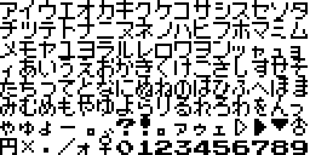
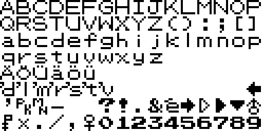
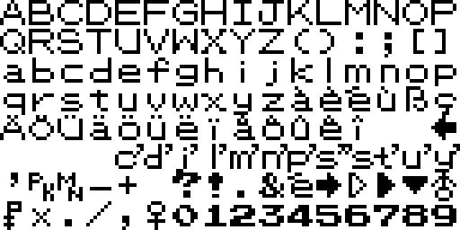
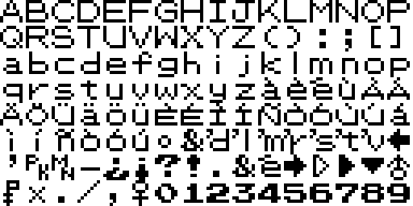
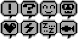
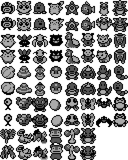
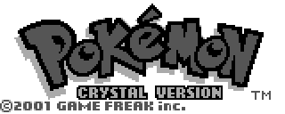
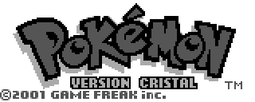
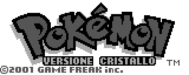
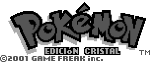

# Pokemon Crystal public graphics

This page is generated from the repository's verified `graphics/` tree. Japanese and Korean assets are listed before English and other official languages.

## Font

| Preview | File | Language | Size | SHA-256 |
| --- | --- | --- | --- | --- |
|  | [`graphics/font/main-font-jp.png`](graphics/font/main-font-jp.png) | Japanese | 512x256 | `924a7bb2dd14aab6...` |
|  | [`graphics/font/main-font-en.png`](graphics/font/main-font-en.png) | English | 512x256 | `a077030977695414...` |
|  | [`graphics/font/main-font-de.png`](graphics/font/main-font-de.png) | German | 512x256 | `21d37c1d3978fbfe...` |
|  | [`graphics/font/main-font-fr.png`](graphics/font/main-font-fr.png) | French | 512x256 | `21d37c1d3978fbfe...` |
|  | [`graphics/font/main-font-it.png`](graphics/font/main-font-it.png) | Italian | 512x256 | `39bb5cade88a18e7...` |
|  | [`graphics/font/main-font-es.png`](graphics/font/main-font-es.png) | Spanish | 512x256 | `39bb5cade88a18e7...` |
|  | [`graphics/font/unown-font.png`](graphics/font/unown-font.png) | Unspecified | 48x144 | `5491e2f08b803a18...` |

## Header

| Preview | File | Language | Size | SHA-256 |
| --- | --- | --- | --- | --- |
|  | [`graphics/header/nintendo-logo-en.png`](graphics/header/nintendo-logo-en.png) | English | 384x64 | `10e9a7189dad4bcc...` |
|  | [`graphics/header/nintendo-logo-de.png`](graphics/header/nintendo-logo-de.png) | German | 384x64 | `10e9a7189dad4bcc...` |
|  | [`graphics/header/nintendo-logo-fr.png`](graphics/header/nintendo-logo-fr.png) | French | 384x64 | `10e9a7189dad4bcc...` |
|  | [`graphics/header/nintendo-logo-it.png`](graphics/header/nintendo-logo-it.png) | Italian | 384x64 | `10e9a7189dad4bcc...` |
|  | [`graphics/header/nintendo-logo-es.png`](graphics/header/nintendo-logo-es.png) | Spanish | 384x64 | `10e9a7189dad4bcc...` |
|  | [`graphics/header/nintendo-logo.png`](graphics/header/nintendo-logo.png) | Unspecified | 384x64 | `10e9a7189dad4bcc...` |

## Overworld

| Preview | File | Language | Size | SHA-256 |
| --- | --- | --- | --- | --- |
|  | [`graphics/overworld/effects-atlas.png`](graphics/overworld/effects-atlas.png) | Unspecified | 64x32 | `8a009e1575e696e7...` |
|  | [`graphics/overworld/emotes-atlas.png`](graphics/overworld/emotes-atlas.png) | Unspecified | 128x64 | `1791e3549e249f6d...` |

Metadata sidecars:

- [`graphics/overworld/emotes-effects-atlas.json`](graphics/overworld/emotes-effects-atlas.json) — `da009cdc83cc6ec2...`

## Pokemon

| Preview | File | Language | Size | SHA-256 |
| --- | --- | --- | --- | --- |
|  | [`graphics/pokemon/footprints-atlas.png`](graphics/pokemon/footprints-atlas.png) | Unspecified | 256x1024 | `137ad03c5f4befa6...` |
|  | [`graphics/pokemon/party-icons-atlas.png`](graphics/pokemon/party-icons-atlas.png) | Unspecified | 256x320 | `74ada4f53da9ecc3...` |

Metadata sidecars:

- [`graphics/pokemon/footprints-atlas.json`](graphics/pokemon/footprints-atlas.json) — `a5a5d8304af975da...`
- [`graphics/pokemon/party-icons-atlas.json`](graphics/pokemon/party-icons-atlas.json) — `255575a4ed718d4b...`

## Title

| Preview | File | Language | Size | SHA-256 |
| --- | --- | --- | --- | --- |
|  | [`graphics/title/title-logo-jp.png`](graphics/title/title-logo-jp.png) | Japanese | 320x128 | `d6da5855159e5a6f...` |
|  | [`graphics/title/title-logo-en.png`](graphics/title/title-logo-en.png) | English | 320x128 | `bcf2b330030af40e...` |
|  | [`graphics/title/title-logo-de.png`](graphics/title/title-logo-de.png) | German | 320x128 | `ee76edbabf58b4c1...` |
|  | [`graphics/title/title-logo-fr.png`](graphics/title/title-logo-fr.png) | French | 320x128 | `1a7ee69e91ec2a61...` |
|  | [`graphics/title/title-logo-it.png`](graphics/title/title-logo-it.png) | Italian | 320x128 | `a4bddec7af4761a5...` |
|  | [`graphics/title/title-logo-es.png`](graphics/title/title-logo-es.png) | Spanish | 320x128 | `b3ab7842279d2d96...` |

Every entry is tied to at least one existing analysis or manifest record. Full hashes and provenance links are in `analysis/public-graphics-catalog.json`.
